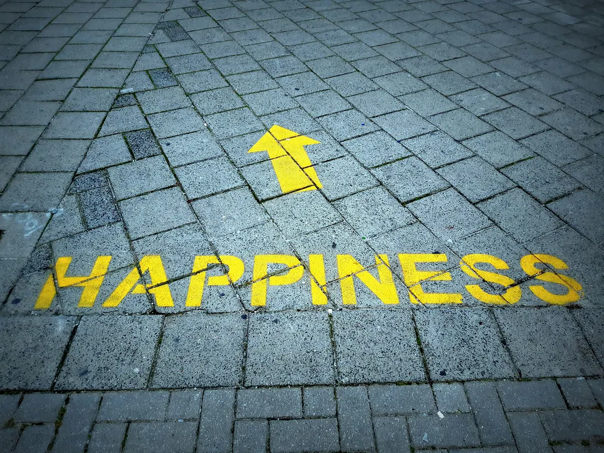

# Is Happiness the Goal? I Doubt.

<h2 class="article-subtitle">Achieving more doesn’t make us happier. Knowing when enough is enough probably does.</h2>

I asked my son what the most important thing in life is. I was just trying to have a conversation that has become very rare these days. I can hardly catch him. He is either sleeping or out with friends. [Gone are the late-night biryani days](growing-up.html).

In seconds, without even thinking, he said, “happiness!”

“Why not contentment?” I asked.

“If I am content, then I won’t be doing anything.”

Is he right? That made me wonder.

## Happy vs content
I can’t remember how many times in the last year I have been really happy. Maybe a couple of times. But that doesn’t mean I have been unhappy.

On any uneventful day, when we are neither particularly happy nor unhappy, what state are we in? I believe that is what contentment is.

Contentment remains with us without giving us any extreme feelings. That doesn’t mean we are emotionless, but our sense of satisfaction is not tied to the highs and lows of everyday life. We go on living our life, without expecting anything out of ordinary.

Happiness needs some stimulus, internal or external. Remembering something from the past, a sense of accomplishment, a promotion, a new car, meeting with a friend after a long time. In order to keep that happiness burning, we talk about it; we try to emulate the same event again and again. But each time it is different. You can never have two moments of happiness be the same.

## Fleeting happiness
Somewhere in between lies what psychologists call the hedonic treadmill. In 1971, psychologists Philip Brickman and Donald Campbell introduced this concept to explain how we adapt to life’s experiences. We tend to return to a certain level of baseline happiness after ups and downs. Even if we are not content, we can still have this underlying sense of being okay.

Any good news, like getting invited to a party at a friend’s place, in my son’s case, can give positive emotion. He starts humming, and movement starts, inside and outside. But the feeling doesn’t remain for a long time. He comes back to his baseline happiness. Similarly, any bad news or setback keeps him upset for only some time. He eventually comes to terms with it or finds a solution and bounces back to the baseline.

That’s how happiness is. It is temporary. We cannot hold onto it for a long time. Whatsoever big the news is, we cannot be excited about it for a long time. It eventually wears off and becomes normal.

## Happiness comes with a price
How to come about this contentment, then? I agree it may not come at an early age. There is so much desire to achieve. [Ambition keeps the fire burning](busyness.html). The more dissatisfaction, the more ambition. And ambition is one such thing that keeps on growing; there is no end to it. Once you achieve something, there is something else to achieve. You have a house; now you need a car. Immediately after you are promoted, you dream of the next promotion.

Maybe we need youngsters to be ambitious. All the technological advancement is due to people questioning the limits of what they already have. What would have happened to us if doctors for generations had not worked relentlessly to find a cure for TB? They were not content people. They were ambitious.

But ambition comes with a cost, and the most visible one is unhappiness. The goal that seemed difficult once achieved becomes the new normal. The desire to achieve more comes back. One lives in perpetual dissatisfaction. [Desires are boundless](richandpoor.html). Every time we meet one, we are someone else, somewhere else. We are no longer the same. We have new goalposts. We believe one more achievement will make us happy forever. But happiness slips each time like sand in the hand.

## Knowing when enough is enough
And perhaps a stage comes when you realise it’s enough. There is nothing more to achieve. You don’t have to chase anything anymore. You are happy to live as you are. Contentment doesn’t take you anywhere. It grounds you. You start looking at the meanings. Tangible values lose their essence, and a deeper sense of belonging comes to you. You don’t compare, you don’t complain, you don’t dream of a different life.

I want to tell my son: don’t bother. Happiness is not the one you should chase. You may have it sometimes, but it will not stay with you forever. Instead, [slow down and live the moments](slowdown.html). Take everything as a lesson. There is no such thing as a failure. Be fascinated, be curious. Learn new things. Enjoy the work you do. [Feel the feels, but don’t take life too seriously](death.html). Setbacks are inevitable. Don’t be disheartened.

More importantly, focus on living each day with gratitude for the privileges you already have.
